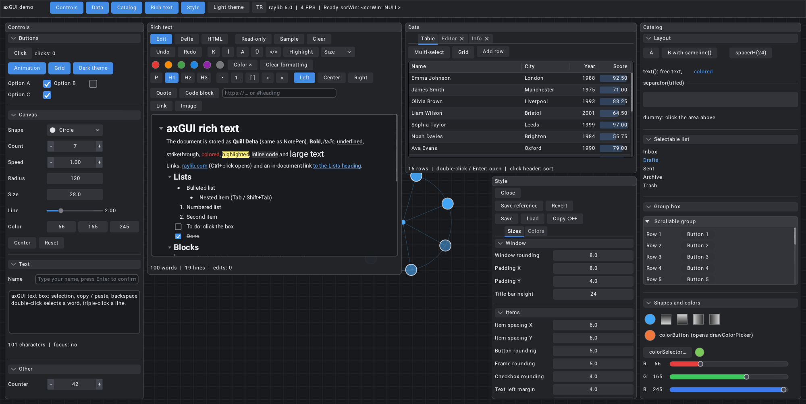

# axGUI

A lightweight immediate-mode C++ GUI library on top of [raylib](https://www.raylib.com) — with an anti-aliased vector renderer, a rich-text editor and a live style editor. This repository holds the library (`src/axGUI`) and its demo / development app.

**[▶ Live demo (WebAssembly)](https://aoktar.net/soft/axGUI-demo/)**

[](https://aoktar.net/soft/axGUI-demo/)

## Highlights

- **Immediate-mode API**, ImGui-like: `if (gui.button("Save")) …`, layout cursor with `newline` / `sameline`, `"Label###id"` IDs
- **Windows**: movable, resizable, scrollable, nested, topmost / popup; focus brings to front (retained draw layers); optional edge snapping (`gui.winSnap`)
- **Widgets**: buttons, toggles, checkboxes, combo boxes with icons, sliders, `dragInt` / `dragFloat` / `dragVec2` / `dragColor`, color picker (HSV, alpha, HEX, eyedropper), selectable lists, group boxes, collapsible sections, tab bars, sortable / resizable / multi-select tables, popup menus, tooltips
- **Text**: single / multi-line text box with selection, clipboard, undo and syntax highlighting; **rich text editor** (Quill Delta model, HTML import / export, headings, lists, to-dos, quotes, code blocks, links, images)
- **axDrawBot renderer**: anti-aliased fills and strokes (ImGui-style AA fringe), rounded rects, circles, arcs, stars, gradients, shadows, sub-pixel text, icons drawn from code into textures
- **Styling**: dark / light themes, every color bound to the theme, live **style editor window** with save / load (JSON) and "copy as C++"
- **i18n**: built-in English / Turkish switching (`axTr`)
- **Platforms**: Windows, Linux, macOS (OpenGL 3.3) and **Web / WebAssembly** (WebGL 2)

## Quick look

```cpp
#include "axGuiSystem.h"

axDrawBot bot; axGUI gui;
bot.init(); gui.bot = &bot; gui.setfont(font, 15);

while (!WindowShouldClose()) {
    BeginDrawing(); ClearBackground(DARKGRAY);
    gui.startFrame(true);

    static vec2 pos(20, 20), size(320, 240);
    gui.beginWindow("Hello###hello", pos, size, WIN_TITLE_BAR | WIN_RESIZABLE | WIN_AUTO_NEWLINE);
    static bool on = false; static float v = 0.5f;
    if (gui.button("Click me", vec2(0, 28))) TraceLog(LOG_INFO, "clicked");
    gui.checkbox("Enabled", &on, vec2(120, 22));
    gui.slider(vec2(0, 14), vec2(200, 28), 0.0f, 1.0f, &v);
    gui.endWindow("###hello");

    gui.endFrame();
    EndDrawing();
}
```
See `src/main.cpp` for a tour of every widget.

## Building

raylib 6.0 is vendored in `libs/` and compiled together with the app — no separate install needed.

**CMake (desktop)**
```
cmake -S . -B build -DCMAKE_BUILD_TYPE=Release
cmake --build build -j
```
On Windows with MinGW add `-G "MinGW Makefiles"`. On Linux, GLFW needs the X11 development packages (`libx11-dev libxrandr-dev libxinerama-dev libxcursor-dev libxi-dev`).

**qmake / Qt Creator** — open `axGUI-demo.pro` with any MinGW / Clang kit (Qt itself is not linked).

**Web (Emscripten)**
```
emcmake cmake -S . -B build-web -DCMAKE_BUILD_TYPE=Release
cmake --build build-web -j
python -m http.server 8080 -d build-web     # open http://localhost:8080/
```
Output: `index.html` + `axGUI-demo.js / .wasm / .data`. Windows shortcut: `web\build-web.bat [emsdk folder]`.

## Demo keys

F1 Controls · F2 Data · F3 theme · F4 Catalog · F5 Rich text · F6 Style editor · F7 English / Türkçe · F11 fullscreen.
Canvas: middle mouse (or Space + drag) to pan, wheel for radius, right click for the menu.

Command line: `--lang tr`, `--light`, `--style`, `--size WxH`, `--screenshot out.png --frames N`.

## Layout

| Path | Contents |
|---|---|
| `src/axGUI/` | The library: `axGuiSystem` (widgets, windows), `axDrawBot.h` (renderer), `axGUITextBox`, `axGUITable`, `axGUIStyle` |
| `src/axGUI/rich/` | Rich text: document model, editor, HTML, clipboard, fonts |
| `src/axGUI/sdf2d/` | SDF 2D renderer |
| `src/main.cpp` | Demo application |
| `libs/` | raylib 6.0 (unmodified), nlohmann/json |
| `resources/` | Roboto fonts, icon atlas |
| `web/` | HTML shell and build scripts for WebAssembly |

## Changelog

See [CHANGELOG.md](CHANGELOG.md).

## License

axGUI is released under the [MIT License](LICENSE).
Third-party: [raylib](libs/raylib-6.0/LICENSE) (zlib), [nlohmann/json](https://github.com/nlohmann/json) (MIT), [Roboto](resources/fonts/LICENSE-Roboto.txt) (Apache 2.0).
